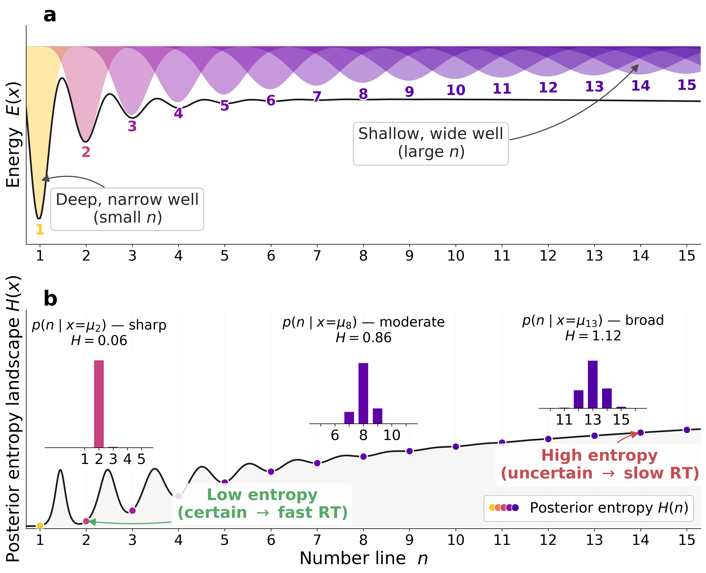

# A Hopfield attractor account of numerosity perception

Research code for the paper **A Hopfield attractor account of numerosity perception**, fitted to behavioural data.  Noisy scalar evidence is refined by gradient descent on an energy landscape until it settles near a discrete numerosity; well spacing and width implement a “useful discreteness” that weakens for larger numbers.

The codebase fits use `scipy` global optimization on empirical summary statistics (accuracy, mean guess, RT where available), with shared simulation logic in `scripts/fit_helpers.py`.  Configuration for well type, noise, RT mode, and optional ablations lives in `configs/config.yaml`.

## Model sketch

```
y₀  →  cleanup (gradient descent on E(x | y₀))  →  x*  →  posterior p(n | x*)  →  loss vs data
```

Energy (Poisson or Gaussian wells; see `fit_helpers` and `docs/`, and the manuscript). Encoding noise and RT linkage are controlled via YAML and the fit scripts.

<p align="center">
  <br>
  <em>Illustration of integer attractor wells along the evidence axis.</em>
</p>

## Setup

```bash
python -m venv .venv
source .venv/bin/activate
pip install -r requirements.txt
```

## Data

Place inputs under `data/` (e.g. Piantadosi estimation trials, De Carli group summaries, Reynvoet Panamath CSV).  Processed outputs and fit artefacts are written under `output/` by the scripts below.

## Project structure

```
scripts/       Fitting, evaluation, density-transition analysis, figure helpers
configs/       YAML defaults for fits (durations, well type, RT mode, priors, …)
data/          Raw / cleaned CSVs and derived tables
output/        Fit summaries, plots, CSVs from analyses
figures/       Publication figures and generators (e.g. `make_fig*.py`)
manuscript/    LaTeX for the paper and supplementary material
docs/          Model notes and session logs
tests/         pytest suite
```

## Main scripts

| Script | Purpose |
|--------|---------|
| `scripts/fit_piantadosi.py` | Single-condition fit to Piantadosi estimation data (wandb run) |
| `scripts/fit_piantadosi_durations.py` | Sweep all exposure durations (40–640 ms); optional bootstrap CIs |
| `scripts/fit_decarli.py` | Separate fits for DD vs controls (accuracy + RT, no trial-level guesses) |
| `scripts/density_transition.py` | Post-fit metrics and “transition to density” figure from duration fits |
| `scripts/run_parameter_recovery.py` | Orchestrates recovery / profile / bootstrap identifiability analyses |
| `scripts/plot_parameter_recovery.py` | Plots from recovery outputs |
| `scripts/plot_decarli_param_boxfacets.py` | De Carli parameter panel figure |
| `scripts/plots.py` | Shared plotting utilities where used by other entry points |

Run from the repository root (e.g. `python scripts/fit_piantadosi.py …` or `python -m scripts.density_transition` as documented in each file).

## Configuration

`configs/config.yaml` drives the attractor variant (e.g. Poisson vs Gaussian wells), fixed vs free parameters, Benford readout prior, duration, RT proxy mode, and related flags.  Individual scripts may expose CLI overrides; check their docstrings.

## Running the tests

```bash
pytest tests/ -v
```

## License

Research code — not intended for production use.
