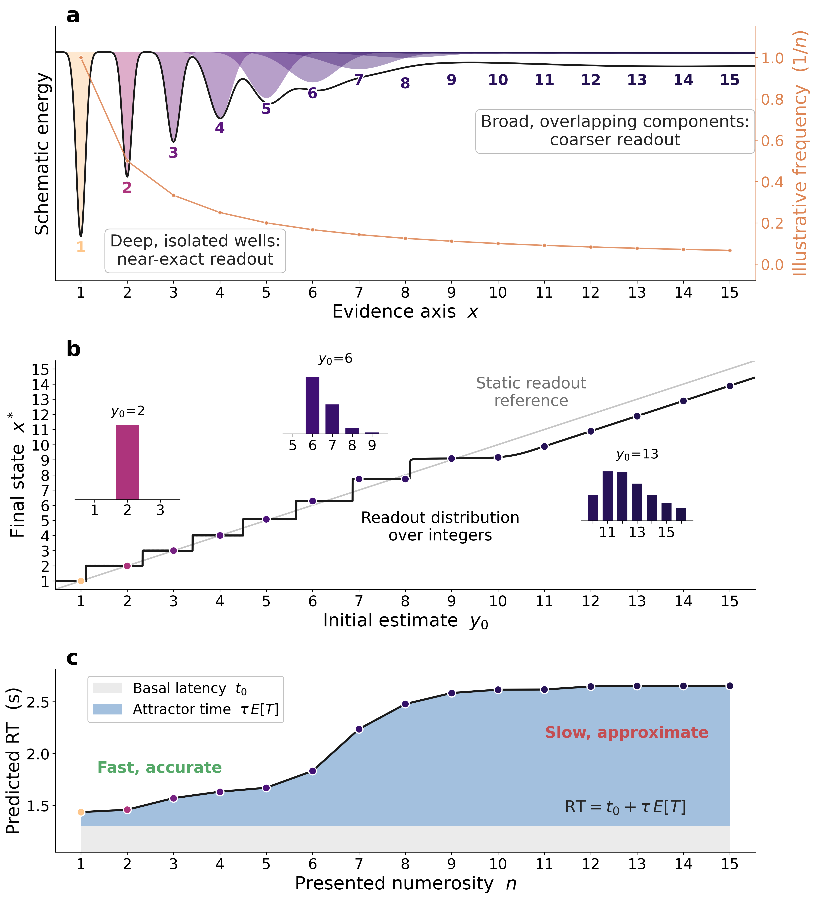

# An attractor account of numerosity perception


https://github.com/user-attachments/assets/5d1fc69e-cd52-463f-81fe-06e1edfd7e26


Research code for the paper **An attractor account of numerosity perception**. The current analysis fits a power-law-width Gaussian attractor directly to 52,995 trial-level enumeration responses collected at five exposure durations (40, 80, 160, 320, and 640 ms).

A single representational landscape is shared across durations, while sensory noise and lapse are duration-specific. Recurrent clean-up maps a noisy scalar estimate onto the integer-centred landscape; where neighbouring wells overlap at larger numerosities, the same representation produces progressively coarser, approximately Weber-like responses. The settling dynamics also provide the response-time predictor.

## Model

```text
noisy estimate y0 -> attractor clean-up -> final state x* -> integer response
                              |
                              +-> bounded settling time -> response time
```

Each stored integer contributes a normalized Gaussian component. Its width grows with magnitude,

```text
sigma_n = sigma_c * n**p,
```

and the components form a log-sum-exp energy landscape. The response likelihood integrates the integer readout over sensory uncertainty using deterministic quadrature and includes a uniform lapse channel, so every observed typed response has positive probability. The primary joint fit shares `sigma_c` and `p` across the five durations and uses duration-specific sensory and lapse parameters. Clean-up is bounded by the shared give-up budget `G = 120`.

<p align="center">
  <br>
  <em>Integer-centred attractor wells, the clean-up map, and the settling-time response-time link.</em>
</p>

## Setup

Python 3.10 or newer is required. From the repository root:

```bash
python -m venv .venv
source .venv/bin/activate
python -m pip install --upgrade pip
python -m pip install -e ".[dev]"
```

The individual-differences fit uses PyTorch on CUDA when available.

## Data and outputs

The primary input is [`data/data_piantadosi.csv`](data/data_piantadosi.csv). The current paper uses its `DURATION` condition and exposure durations from 40 to 640 ms.

Generated fit tables and diagnostics are written to `output/`; publication figures are written to `figures/`. The central response, RT, recovery, Weber, and individual-differences results are under `output/trial_level_model_comparison/`. Expensive fitted outputs are committed, so figures can be rebuilt without rerunning every optimizer.

## Project structure

```text
scripts/            Current fitting, validation, and figure scripts
configs/            Numerical support and shared low-level defaults
data/               Source and processed behavioural data
output/             Fit summaries, caches, and diagnostics
figures/            Main-text and supplementary figures
manuscript/         Main paper, supplement, and three response letters
driven_attractor/   Separate analysis of the continuously driven alternative
deprecated/         Superseded Poisson and per-duration pipelines
docs/               Technical and analysis notes
```

## Core analyses

Run all commands from the repository root.

| Script | Purpose |
|---|---|
| `scripts/trial_level_model_comparison.py` | Shared trial-level likelihood, model definitions, quadrature, and data loading |
| `scripts/trial_level_shared_landscape_ladder.py` | Joint response-model comparison with one landscape across all durations |
| `scripts/trial_level_clean_up_budget.py` | Profile likelihood for the shared give-up budget `G` |
| `scripts/trial_level_cp_exact.py` | Trial-level fit of the published and lapse-matched C&P bounded-optimal model |
| `scripts/trial_level_rt_joint.py` | Response-time links fitted on the fixed winning landscape |
| `scripts/trial_level_recovery_winner.py` | Joint parameter recovery for the shared-landscape model |
| `scripts/trial_level_bivariate_id.py` | All-duration hierarchical association between landscape resolution and Weber noise, conditional on participant lapse |
| `scripts/trial_level_pexact_decomposition.py` | Contribution of clean-up to exact-response probability |
| `scripts/trial_level_weber_fraction.py` | Effective Weber fraction of the fitted response distributions |

A typical regeneration sequence is:

```bash
# Primary response fit and external benchmark
.venv/bin/python -m scripts.trial_level_shared_landscape_ladder
.venv/bin/python -m scripts.trial_level_cp_exact

# Response-time and secondary analyses
.venv/bin/python -m scripts.trial_level_rt_joint
.venv/bin/python -m scripts.trial_level_weber_fraction
.venv/bin/python -m scripts.trial_level_pexact_decomposition
.venv/bin/python -m scripts.trial_level_bivariate_id

# Main figures
.venv/bin/python -m scripts.figure1_conceptual_attractor_wells
.venv/bin/python -m scripts.figure2_model_comparison
.venv/bin/python -m scripts.trial_level_cofit_figure
```

The core response fit and recovery analysis are computationally expensive. Use `--smoke` with `trial_level_shared_landscape_ladder.py` or `trial_level_recovery_winner.py` for a short pipeline check. The continuously
driven accumulator has its own reproducibility instructions in [`driven_attractor/README.md`](driven_attractor/README.md).

## Configuration

`configs/config.yaml` supplies shared numerical constants such as the stimulus range and response support. Script-specific command-line options are documented in each module's docstring and `--help` output.

## Licence

Research code.
