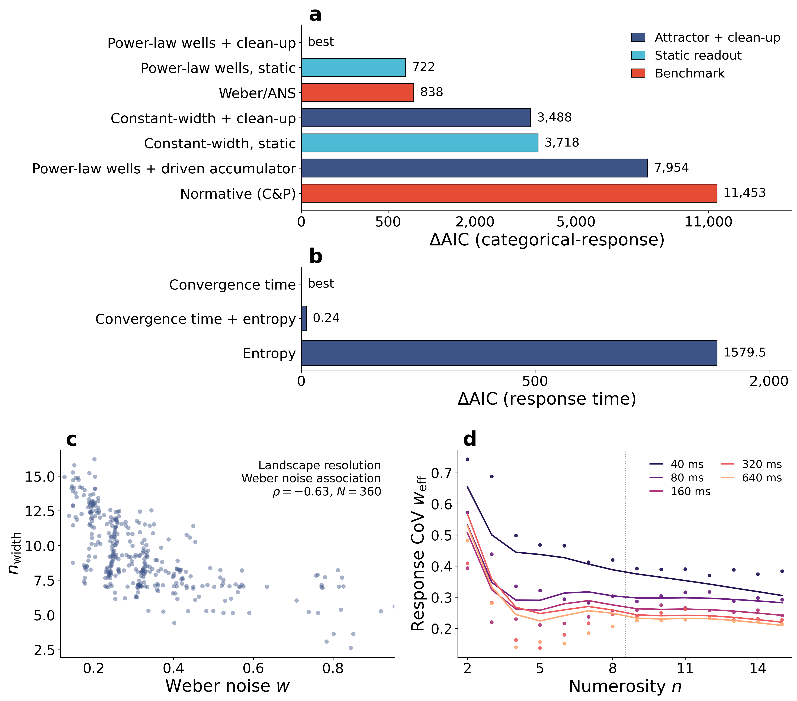
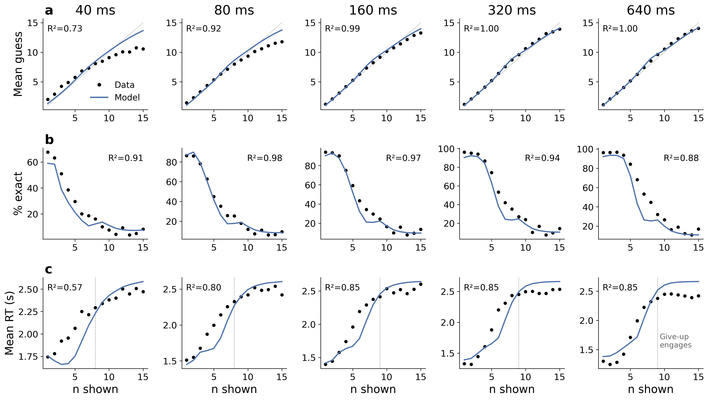

# An attractor account of numerosity readout

<p align="center">
  <a href="https://doi.org/10.1177/20416695261488294"></a>
  <a href="https://doi.org/10.1177/20416695261488294"></a>
  <a href="https://osf.io/svcy5/"></a>
  
</p>

Why do we see three dots at a glance, but have to guess when there are eight? This repository holds the code, fitted outputs and figures behind a paper that answers with a single mechanism: the numbers we know behave like the valleys of a landscape, and a noisy estimate of a set's size simply rolls downhill into the nearest one.

> Correig-Fraga, E. (2026). **An attractor account of numerosity readout.** *i-Perception*, 17(5), 1–15. https://doi.org/10.1177/20416695261488294

The whole story in four minutes:


https://github.com/user-attachments/assets/78428688-36b2-4930-b0d1-711285698002


## The idea

The textbook account of numerical perception uses two systems: an exact one that tracks up to about four objects, and an approximate one whose noise grows with magnitude, following Weber's law. Yet accuracy and response time fall off smoothly with set size, with no visible border where one system hands over to the other. Gallistel and Gelman suggested in 1992 that a single representation whose precision degrades with magnitude could do both jobs. This paper gives that idea a working mechanism, borrowed from Hopfield's 1982 memory networks.

Each integer is a stored memory: a well on a one-dimensional energy landscape, the mental number line. Small numbers get deep, narrow wells. Large numbers get broad wells that overlap with their neighbours. Upstream vision hands the network a noisy estimate of how many dots there were. That estimate is the starting point, and recurrent clean-up pulls it downhill until it settles in a well. The integer at the bottom is the answer, and the number of steps it took to settle is the response time.

<p align="center">
  <br>
  <em>One landscape, two behaviours. (a) Wells widen with magnitude. (b) Clean-up snaps small estimates to an integer and leaves large ones spread over several. (c) Settling time rises with numerosity until the give-up budget caps it.</em>
</p>

Nothing switches between a small-number regime and a large-number regime. The wells just widen, so the same dynamics give near-categorical answers for three and Weber-like spread for thirteen.

## The model in three lines

```text
noisy estimate y0  ->  attractor clean-up  ->  final state x*  ->  integer response
                              |
                              +->  settling steps, capped at G = 120  ->  response time
```

Every integer `n` contributes a normalized Gaussian well of width `sigma_n = sigma_c * n**p`, and the wells combine through a log-sum-exp energy. One landscape (`sigma_c`, `p`) is shared across all exposure durations; only sensory noise and a lapse rate are duration-specific. The response likelihood integrates the integer readout over sensory uncertainty with deterministic quadrature, and a uniform lapse channel gives every typed response positive probability.

## What the data say

We refitted 52,995 enumeration trials from 379 adults in the open dataset of Cheyette and Piantadosi (2020), who flashed 1 to 15 dots for 40, 80, 160, 320 or 640 ms. Every model is scored on the individual integer responses, not on summary curves.

**The landscape with clean-up wins.** ΔAIC relative to the winning model on the response channel, all five durations fitted jointly:

| Model | ΔAIC |
|---|---:|
| Power-law wells + clean-up | best |
| Power-law wells, static readout | 722 |
| Weber / approximate number system | 838 |
| Constant-width wells + clean-up | 3,488 |
| Constant-width wells, static readout | 3,718 |
| Power-law wells + driven accumulator | 7,954 |
| Bounded-optimal normative model (Cheyette & Piantadosi) | 11,453 |

Both ingredients matter. Wells that widen with magnitude beat constant-width wells by thousands of AIC units, and clean-up beats a static readout of the same landscape by hundreds.

**Response time comes for free.** The number of clean-up steps, with one mapping shared across durations, is the best response-time predictor. Adding readout entropy moves the AIC by 0.24. The finite stopping budget `G` reproduces the response-time plateau at large numerosities.

**Everyone has their own landscape.** Participants whose wells stay separate up to larger numbers, fitted on trials with 8 dots or fewer, are less noisy when estimating large sets on a disjoint set of trials with 9 dots or more. The latent correlation is ρ = −0.63 across 360 participants.

<p align="center">
  <br>
  <em>Figure 2. (a) Response-channel model ladder. (b) Response-time links. (c) Landscape resolution against Weber noise, one dot per participant. (d) Effective Weber fraction of the fitted model (lines) and data (dots).</em>
</p>

<p align="center">
  <br>
  <em>Figure 3. The joint fit against the data, per exposure duration: mean guess, exact accuracy and geometric-mean response time.</em>
</p>

## Reproduce it

Python 3.10 or newer. From the repository root:

```bash
python -m venv .venv
source .venv/bin/activate
python -m pip install --upgrade pip
python -m pip install -e ".[dev]"
```

The expensive fitted outputs are committed under `output/`, so the figures rebuild in seconds without rerunning any optimizer. The fits themselves take minutes to hours on a laptop; the hierarchical individual-differences model uses PyTorch and runs on CUDA when available. Scripts with a `--smoke` flag have a fast, approximate mode for checking that everything runs.

| What | Command | Writes to |
|---|---|---|
| Primary joint fit and the model ladder (Fig. 2a) | `python -m scripts.trial_level_shared_landscape_ladder` | `output/trial_level_model_comparison/shared_landscape_ladder*.csv` |
| Cheyette & Piantadosi benchmark on the same ladder | `python -m scripts.trial_level_cp_exact` | `output/cp_exact/` |
| Response-time link on the fitted landscape (Fig. 2b) | `python -m scripts.trial_level_rt_joint` | `.../rt_joint.csv` |
| Landscape resolution vs Weber noise (Fig. 2c) | `python -m scripts.trial_level_bivariate_id` | `.../bivariate_id_*.csv` |
| Effective Weber fraction (Fig. 2d) | `python -m scripts.trial_level_weber_fraction` | `.../weber_fraction.csv` |
| Parameter recovery (Supp. Fig. 2) | `python -m scripts.trial_level_recovery_winner` | `.../recovery_winner*.csv` |
| Clean-up budget profile (Supp. Mat. 2) | `python -m scripts.trial_level_clean_up_budget` | `.../clean_up_budget_profile.csv` |
| Figure 1 | `python -m scripts.figure1_conceptual_attractor_wells` | `figures/figure1_*` |
| Figure 2 | `python -m scripts.figure2_model_comparison` | `figures/figure2_*` |
| Figure 3 | `python -m scripts.trial_level_cofit_figure` | `figures/figure3_*` |

The developmental-dyscalculia analysis in the supplement (De Carli et al., 2020) lives in the `scripts/decarli_*.py` family and writes to `output/decarli_fit/`.

## Repository map

```text
scripts/            Fitting, validation and figure scripts (run as modules: python -m scripts.<name>)
configs/            Numerical support and shared low-level defaults
data/               Source and processed behavioural data
output/             Fit summaries, caches and diagnostics (committed, so figures rebuild without refitting)
figures/            Main-text and supplementary figures
manuscript/         Paper and supplementary material (LaTeX)
driven_attractor/   Separate analysis of the continuously driven alternative
deprecated/         Superseded Poisson and per-duration pipelines
docs/               Technical and analysis notes
```

## Data

The main input is [`data/data_piantadosi.csv`](data/data_piantadosi.csv), the enumeration data of Cheyette, S. J. and Piantadosi, S. T. (2020), *A unified account of numerosity perception*, Nature Human Behaviour, 4, 1265–1272, available at https://osf.io/svcy5/. The analysis uses its `DURATION` condition. The supplement also refits the exact-enumeration data of De Carli et al. (2020), *Impaired large numerosity estimation and intact subitizing in developmental dyscalculia*, PLoS ONE, 15, e0244578, stored in [`data/decarli_exact_enumeration.csv`](data/decarli_exact_enumeration.csv).

## Cite

```bibtex
@article{correigfraga2026attractor,
  author  = {Correig-Fraga, Eudald},
  title   = {An attractor account of numerosity readout},
  journal = {i-Perception},
  year    = {2026},
  volume  = {17},
  number  = {5},
  pages   = {1--15},
  doi     = {10.1177/20416695261488294}
}
```

## About

Written by Eudald Correig-Fraga at [Innovamat Education](https://www.innovamat.com), which funded the work. Questions and ideas are welcome: open an issue or write to eudald.correig@innovamat.com.
